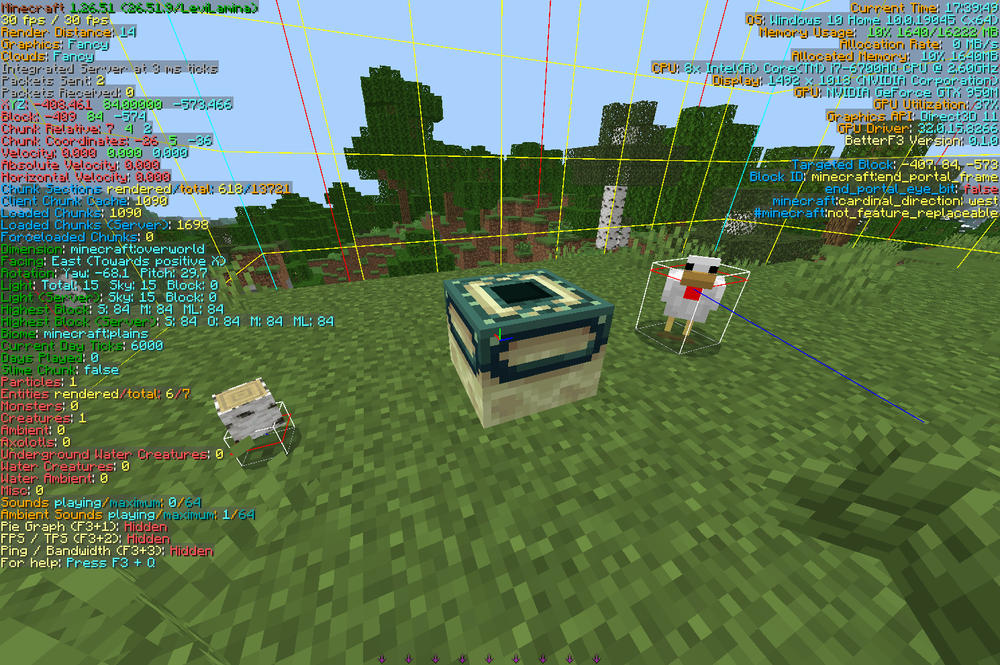

# BetterF3 for Bedrock

[English](README.md)



Minecraft 統合版に、自由に組み替えられる F3 デバッグ画面を足す Mod です。Java 版の Mod [BetterF3](https://github.com/TreyRuffy/BetterF3)（作者 cominixo / TreyRuffy）を [LeviLamina](https://github.com/LiteLDev/LeviLamina) 向けに移植したものです。

> 本家 BetterF3 の作者とは関係のない、非公式の移植です。

## 必要なもの

| | 版 |
|---|---|
| Minecraft 統合版 | 1.26.51（Windows） |
| LeviLamina | 26.51.x（client） |

## 導入

**lip**

```
lip install github.com/ch1-k-mc/BetterF3-Bedrock#client
```

LeviLamina（client）のゲームフォルダで実行します。

**手動**: [Releases](../../releases) から `BetterF3-client-windows-x64.zip` をダウンロードし、`BetterF3` フォルダを `mods/` に置きます。

## 使い方

| キー | 動作 |
|---|---|
| `F3` | デバッグ画面を開く / 閉じる |
| `F3` + `M` | 設定画面を開く |
| `F3` + `Q` | キー操作の一覧を出す |

すべてのキー・設定画面・コマンド・設定ファイルは [使い方](docs/USAGE.ja.md) を見てください。

## 機能

- 本家の 15 のモジュールを画面の左右に表示
- 設定画面でモジュールと行の並び替え・色の変更・表示の切り替え
- F3 + キーの操作: 当たり判定・チャンクの境界・位置のコピー・詳細なツールチップ・ゲームモードの切り替えなど
- 処理時間・FPS / TPS・遅延 / 通信量のグラフ
- マルチプレイのサーバーの情報
- 英語・日本語

一覧は [機能](docs/FEATURES.ja.md) を見てください。

## ビルド

[xmake](https://xmake.io)、Visual Studio 2022 以降、clang-cl が必要です。

```
xmake f -m release -y
xmake
```

`bin/BetterF3/` に出力されます。

## ライセンス

[MIT](LICENSE)。cominixo / TreyRuffy の [BetterF3](https://github.com/TreyRuffy/BetterF3)（MIT）をもとにしています。詳しくは [NOTICE](NOTICE.md)。
