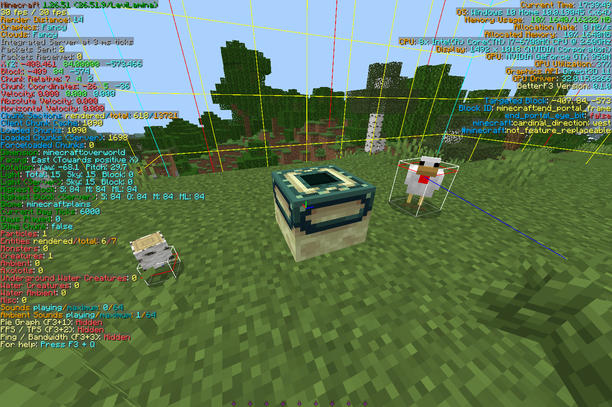

# BetterF3 for Bedrock

[日本語](README.ja.md)



A customizable F3 debug screen for Minecraft: Bedrock Edition. A [LeviLamina](https://github.com/LiteLDev/LeviLamina) port of the Java Edition mod [BetterF3](https://github.com/TreyRuffy/BetterF3) by cominixo / TreyRuffy.

> This is an unofficial port, not affiliated with the authors of the original BetterF3.

## Requirements

| | Version |
|---|---|
| Minecraft: Bedrock Edition | 1.26.51 (Windows) |
| LeviLamina | 26.51.x client |

## Installation

**lip**

```
lip install github.com/ch1-k-mc/BetterF3-Bedrock
```

**Manual**: download `BetterF3-client-windows-x64.zip` from [Releases](../../releases) and extract the `BetterF3` folder into `mods/`.

## Usage

| Key | Action |
|---|---|
| `F3` | Open / close the debug screen |
| `F3` + `M` | Open the settings screen |
| `F3` + `Q` | List all key combinations |

See [Usage](docs/USAGE.md) for all keys, the settings screen, commands and the config file.

## Features

- All 15 modules of the original, on the left and right of the screen
- Reorder, recolor and hide modules and lines in the settings screen
- F3 key combinations: hitboxes, chunk borders, copy location, advanced tooltips, game mode switcher and more
- Profiler, FPS / TPS and ping / bandwidth charts
- Server information on multiplayer servers
- English and Japanese

See [Features](docs/FEATURES.md) for the full list.

## Building

Requires [xmake](https://xmake.io), Visual Studio 2022 or later, and clang-cl.

```
xmake f -m release -y
xmake
```

The mod is output to `bin/BetterF3/`.

## License

[MIT](LICENSE). Based on [BetterF3](https://github.com/TreyRuffy/BetterF3) (MIT) by cominixo / TreyRuffy. See [NOTICE](NOTICE.md).
