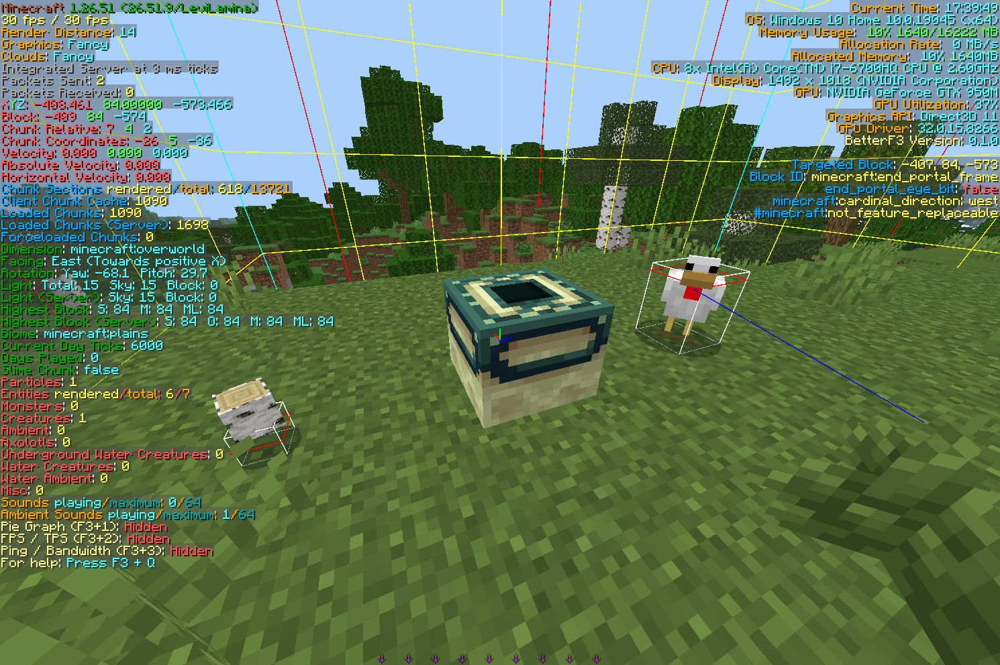

# BetterF3 for Bedrock

[English](README.md) | [日本語](README.ja.md) | [繁體中文](README.zh-TW.md)



为 Minecraft 基岩版添加可自由定制的 F3 调试界面。本模组是 cominixo / TreyRuffy 的 Java 版模组 [BetterF3](https://github.com/TreyRuffy/BetterF3) 的 [LeviLamina](https://github.com/LiteLDev/LeviLamina) 移植版。

> 这是非官方移植，与原版 BetterF3 的作者无关。

## 运行要求

| | 版本 |
|---|---|
| Minecraft 基岩版 | 1.26.60（Windows） |
| LeviLamina | 26.60.x |

Minecraft 1.26.51 请参阅[旧版本](#旧版本)。

## 安装

**lip**

```
lip install github.com/ch1-k-mc/BetterF3-Bedrock
```

请在 LeviLamina（client）的游戏目录中运行。

**手动**：从 [Releases](../../releases) 下载 `BetterF3-client-windows-x64.zip`，将其中的 `BetterF3` 文件夹放入 `mods/`。

## 旧版本

| Minecraft | LeviLamina | BetterF3 |
|---|---|---|
| 1.26.60 | 26.60.x | 0.2.0 及以上（本分支） |
| 1.26.51 | 26.51.x | [0.1.0](../../releases/tag/v0.1.0)（源码：[`mc-1.26.51` 分支](../../tree/mc-1.26.51)） |

使用 lip：`lip install github.com/ch1-k-mc/BetterF3-Bedrock#client@0.1.0`

## 使用方法

| 按键 | 功能 |
|---|---|
| `F3` | 打开 / 关闭调试界面 |
| `F3` + `M` | 打开设置界面 |
| `F3` + `Q` | 显示所有快捷键 |

全部按键、设置界面、命令和配置文件请参阅[使用方法](docs/USAGE.zh-CN.md)。

## 功能

- 原版的全部 15 个模块，显示在屏幕左右两侧
- 在设置界面中对模块和行进行排序、改色、显示 / 隐藏
- F3 组合键：实体碰撞箱、区块边界、复制位置、高级提示框、游戏模式切换等
- 性能分析、FPS / TPS、延迟 / 带宽图表
- 多人游戏服务器信息
- 英语、日语、中文

完整列表请参阅[功能](docs/FEATURES.zh-CN.md)。

## 构建

需要 [xmake](https://xmake.io)、Visual Studio 2022 或更高版本，以及 clang-cl。

```
xmake f -m release -y
xmake
```

模组输出到 `bin/BetterF3/`。

## 许可证

[MIT](LICENSE)。基于 cominixo / TreyRuffy 的 [BetterF3](https://github.com/TreyRuffy/BetterF3)（MIT）。详见 [NOTICE](NOTICE.md)。
