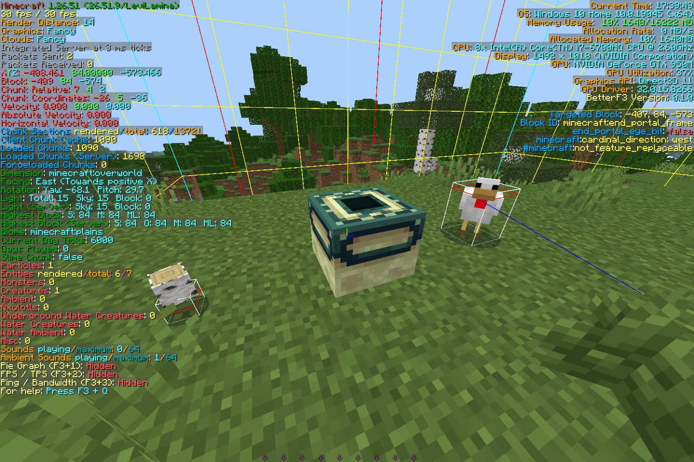

# BetterF3 for Bedrock

[English](README.md) | [日本語](README.ja.md) | [简体中文](README.zh-CN.md)



為 Minecraft 基岩版加入可自由調整的 F3 除錯畫面。本模組是 cominixo / TreyRuffy 的 Java 版模組 [BetterF3](https://github.com/TreyRuffy/BetterF3) 的 [LeviLamina](https://github.com/LiteLDev/LeviLamina) 移植版。

> 這是非官方移植，與原版 BetterF3 的作者無關。

## 執行需求

| | 版本 |
|---|---|
| Minecraft 基岩版 | 1.26.60（Windows） |
| LeviLamina | 26.60.x |

Minecraft 1.26.51 請參閱[舊版本](#舊版本)。

## 安裝

**lip**

```
lip install github.com/ch1-k-mc/BetterF3-Bedrock
```

請在 LeviLamina（client）的遊戲資料夾中執行。

**手動**：從 [Releases](../../releases) 下載 `BetterF3-client-windows-x64.zip`，將其中的 `BetterF3` 資料夾放入 `mods/`。

## 舊版本

| Minecraft | LeviLamina | BetterF3 |
|---|---|---|
| 1.26.60 | 26.60.x | 0.2.0 以上（本分支） |
| 1.26.51 | 26.51.x | [0.1.0](../../releases/tag/v0.1.0)（原始碼：[`mc-1.26.51` 分支](../../tree/mc-1.26.51)） |

使用 lip：`lip install github.com/ch1-k-mc/BetterF3-Bedrock#client@0.1.0`

## 使用方式

| 按鍵 | 功能 |
|---|---|
| `F3` | 開啟 / 關閉除錯畫面 |
| `F3` + `M` | 開啟設定畫面 |
| `F3` + `Q` | 顯示所有按鍵組合 |

所有按鍵、設定畫面、指令與設定檔請參閱[使用方式](docs/USAGE.zh-TW.md)。

## 功能

- 原版的全部 15 個模組，顯示在畫面左右兩側
- 在設定畫面中對模組與行進行排序、變更顏色、顯示 / 隱藏
- F3 按鍵組合：實體碰撞箱、區塊邊界、複製位置、進階提示框、遊戲模式切換等
- 效能分析、FPS / TPS、延遲 / 頻寬圖表
- 多人遊戲伺服器資訊
- 英文、日文、中文

完整清單請參閱[功能](docs/FEATURES.zh-TW.md)。

## 建置

需要 [xmake](https://xmake.io)、Visual Studio 2022 或更新版本，以及 clang-cl。

```
xmake f -m release -y
xmake
```

模組會輸出到 `bin/BetterF3/`。

## 授權

[MIT](LICENSE)。基於 cominixo / TreyRuffy 的 [BetterF3](https://github.com/TreyRuffy/BetterF3)（MIT）。詳見 [NOTICE](NOTICE.md)。
